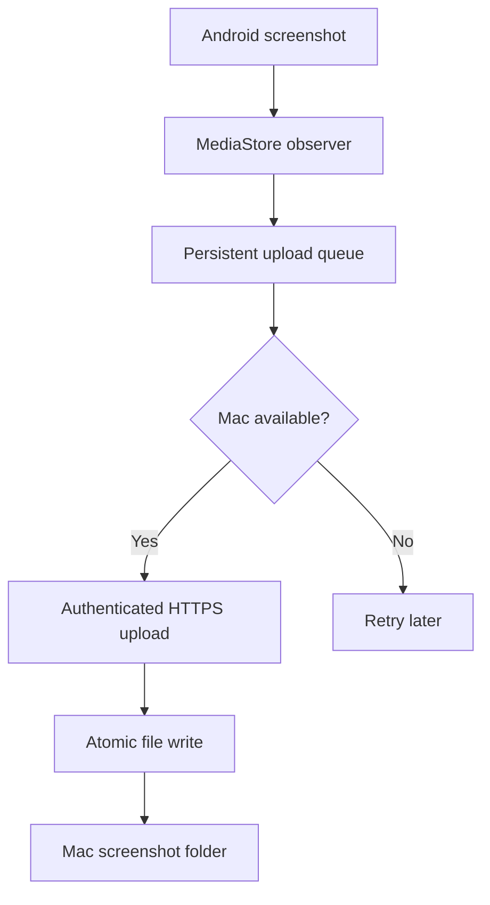

# Specification: Android-to-Mac Instant Screenshot Sync

## 1. Objective

Build a utility that automatically transfers screenshots taken on an Android phone to a user-selected folder on a Mac as quickly as possible.

The system must transfer screenshots directly from Android to macOS. Google Photos, Google Drive, or another cloud-storage provider must not be part of the transfer path.

### Performance target

* Same Wi-Fi, Mac awake: median transfer time below 2 seconds.
* Remote connection through Tailscale: normally below 5 seconds.
* Screenshots taken while the Mac is unavailable must upload automatically when connectivity returns.
* No screenshots may be silently lost.

## 2. Project structure

Create a monorepo:

```text
shot-sync/
├── android/
├── mac/
├── protocol/
├── scripts/
├── docs/
├── README.md
└── LICENSE
```

### Technology choices

#### Android client

* Kotlin
* Android Studio project
* Jetpack Compose
* Minimum SDK: Android 10/API 29
* Target the current stable Android SDK
* Room for the upload queue
* OkHttp for networking
* WorkManager for recovery and retries
* `MediaStore` and `ContentObserver` for screenshot detection
* ZXing or equivalent for QR pairing

#### Mac receiver

* Go
* One self-contained executable
* Minimal menu-bar interface if practical
* Bonjour/mDNS for local discovery
* Native macOS notifications
* `launchd` integration
* No external database
* SQLite or a compact local state file for deduplication

Prioritize reliable core functionality over interface polish.

## 3. System architecture



## 4. Android application

### 4.1 Initial setup

On first launch, the application must guide the user through:

1. Granting access to images.
2. Granting notification permission where required.
3. Selecting or confirming the screenshots folder.
4. Excluding the application from battery optimization.
5. Pairing with the Mac by scanning a QR code.
6. Enabling automatic synchronization.

Display a clear setup status for every required permission.

### 4.2 Screenshot detection

Register a `ContentObserver` against:

```kotlin
MediaStore.Images.Media.EXTERNAL_CONTENT_URI
```

When notified of a change:

1. Query recently added images.
2. Wait until `IS_PENDING` is `0`.
3. Identify screenshots using:

   * `RELATIVE_PATH`, primarily `Pictures/Screenshots/`
   * Known manufacturer-specific screenshot paths
   * Optional filename fallback containing `Screenshot`
4. Ignore images older than the observer’s most recent checkpoint.
5. Add matching images to the persistent upload queue.

Do not assume that every Android manufacturer uses exactly the same path.

Store at least:

```text
media_store_id
content_uri
display_name
relative_path
mime_type
size
date_added
sha256
status
attempt_count
last_attempt_at
created_at
```

### 4.3 Immediate synchronization

For the lowest possible latency:

* Run a user-enabled foreground monitoring service.
* Display a permanent low-priority notification such as:

```text
Shot Sync is monitoring for screenshots
```

* Use the appropriate Android foreground-service declaration for continuous, user-enabled media monitoring.
* Do not incorrectly declare a continuously running `dataSync` service, because current Android versions impose cumulative time limits on that service type.
* Document any platform limitations and any manufacturer-specific battery settings.

When a screenshot is detected:

1. Confirm that the file is complete.
2. Compute its SHA-256 hash while streaming where possible.
3. Start uploading immediately.
4. Avoid copying the whole image into memory.
5. Mark it complete only after receiving a valid server acknowledgement.

### 4.4 Recovery mechanism

The application must not depend exclusively on the live observer.

Implement:

* A reconciliation scan when the application starts.
* A reconciliation scan when monitoring is enabled.
* WorkManager retry jobs when uploads fail.
* Network-change recovery.
* Recovery after the device restarts.
* A manual “Scan for missed screenshots” command.

The reconciliation scan should compare recent screenshots against completed and queued records.

### 4.5 Queue behavior

Upload states:

```text
DISCOVERED
READY
UPLOADING
COMPLETED
RETRY_WAIT
FAILED
```

Requirements:

* Exponential retry with sensible limits.
* Never remove a queue entry solely because an upload timed out.
* Treat an existing matching hash on the Mac as successful.
* Limit concurrent uploads to one by default.
* Upload older queued screenshots before newer ones.
* Allow the user to retry failed items manually.
* Keep completed history for a configurable period, default 30 days.

### 4.6 Android interface

The main screen should show:

* Monitoring enabled or disabled.
* Paired Mac name.
* Connection method:

  * Local network
  * Tailscale
  * Offline
* Last successful transfer.
* Number of queued screenshots.
* Recent transfer history.
* A “Send test image” button.
* A “Scan for missed screenshots” button.
* A settings button.

Settings:

* Enable or disable monitoring.
* Screenshot folders.
* Destination subfolder.
* Local-network preference.
* Tailscale fallback hostname.
* Upload on Wi-Fi only toggle.
* Notification toggle.
* Retention period for local history.
* Unpair Mac.
* Export diagnostic logs.

## 5. Mac receiver

### 5.1 Installation

Provide:

```bash
shotsync install --destination /absolute/user-selected/path
shotsync uninstall
shotsync start
shotsync stop
shotsync status
shotsync logs
```

`shotsync install` must:

1. Install the executable in an appropriate user-accessible location.
2. Create a per-user `launchd` agent.
3. Configure startup when the user logs in.
4. Create the destination folder.
5. Start the receiver.
6. Avoid requiring root privileges where possible.
7. Require the user to select an absolute destination path; do not infer one
   from a username, home-directory layout, or computer name.

Required destination example:

```text
/absolute/path/selected/during/installation
```

### 5.2 Menu-bar application

If implemented, the menu-bar interface should include:

* Receiver status.
* Android device connection status.
* Last received screenshot.
* Open screenshots folder.
* Show pairing QR code.
* Pause receiving.
* Preferences.
* View logs.
* Quit.

The receiver must still work without the preferences window being open.

### 5.3 Local discovery

Advertise a Bonjour/mDNS service:

```text
_shotsync._tcp
```

Include non-sensitive metadata:

```text
protocol_version
device_id
device_name
port
```

Do not advertise authentication tokens or private keys.

The Android application should prefer the locally discovered Mac over a remote address.

### 5.4 Remote access

Support an optional Tailscale hostname or IP.

Example:

```text
receiver-alias.tailnet-name.ts.net
```

Selection order:

1. Discovered local-network endpoint.
2. Configured Tailscale endpoint.
3. Offline queue.

The application does not need to manage or install Tailscale. It should only connect through Tailscale when configured.

## 6. Pairing and security

Screenshots may contain passwords, financial details, conversations, or other sensitive information. Do not send them over unauthenticated plaintext HTTP.

### 6.1 Initial pairing

The Mac generates:

* A unique device ID.
* A TLS private key and certificate.
* A cryptographically secure pairing secret.
* A QR code containing:

```json
{
  "version": 1,
  "device_id": "uuid",
  "device_name": "ShotSync Receiver",
  "local_host": "shotsync-a1b2c3d4e5f6.local",
  "port": 47831,
  "certificate_fingerprint": "sha256-fingerprint",
  "pairing_secret": "one-time-secret"
}
```

The one-time pairing secret must expire after a short period, default five minutes.

After pairing:

* Exchange a permanent device-specific access token.
* Invalidate the one-time secret.
* Store secrets using Android Keystore and macOS Keychain.
* Pin the Mac certificate or public-key fingerprint on Android.
* Never disable TLS certificate validation globally.

### 6.2 Authentication

Every request must include device authentication.

Acceptable implementation:

```http
Authorization: Bearer <device-specific-token>
```

Requirements:

* Generate at least 256 bits of randomness.
* Tokens must be revocable.
* Log the device ID, but never log tokens.
* Use constant-time comparisons.
* Provide a way to unpair and rotate credentials.

### 6.3 Receiver protections

The Mac receiver must:

* Reject unauthenticated requests.
* Reject invalid certificate expectations.
* Enforce a configurable maximum file size, default 30 MB.
* Permit only expected image MIME types.
* Sanitize filenames.
* Prevent path traversal.
* Rate-limit abusive or malfunctioning clients.
* Never execute or automatically open uploaded files.
* Bind only to configured interfaces.
* Avoid exposing the service to the public internet.

## 7. Upload protocol

### Endpoint

```http
POST /api/v1/screenshots
```

Suggested headers:

```http
Authorization: Bearer <token>
X-ShotSync-Device-ID: <device-id>
X-ShotSync-File-ID: <uuid>
X-ShotSync-SHA256: <hash>
X-ShotSync-Captured-At: <ISO-8601>
Content-Type: image/png
Content-Length: <bytes>
```

Send the raw image as the request body to minimize overhead.

### Successful response

```json
{
  "status": "stored",
  "file_id": "uuid",
  "sha256": "hash",
  "filename": "Screenshot_2026-08-14_09-45-21.png",
  "stored_at": "2026-08-14T09:45:22+02:00"
}
```

### Duplicate response

```json
{
  "status": "already_exists",
  "file_id": "uuid",
  "sha256": "hash",
  "filename": "Screenshot_2026-08-14_09-45-21.png"
}
```

Both `stored` and `already_exists` count as successful delivery.

### Health endpoint

```http
GET /api/v1/health
```

Return:

```json
{
  "status": "ok",
  "protocol_version": 1,
  "device_name": "ShotSync Receiver"
}
```

Do not expose filesystem paths, secrets, usernames, or unnecessary system information.

## 8. File handling

Use the original filename when safe.

If a collision occurs:

```text
Screenshot_2026-08-14_09-45-21.png
Screenshot_2026-08-14_09-45-21_2.png
```

Write atomically:

1. Create a temporary file inside the destination filesystem.
2. Stream the request into the temporary file.
3. Calculate and validate SHA-256.
4. Flush and close the file.
5. Rename it into the final destination.
6. Record the completed transfer.
7. Send the acknowledgement.

Delete incomplete temporary files after crashes or a configurable timeout.

Preserve the original capture timestamp as the file modification time when possible.

## 9. Reliability requirements

The implementation must handle:

* Mac sleeping during upload.
* Phone changing between Wi-Fi and mobile data.
* Duplicate `MediaStore` notifications.
* Android terminating the application process.
* Receiver restart during upload.
* Network interruption halfway through a file.
* Two screenshots taken rapidly.
* Identical screenshots with different filenames.
* Filename collisions.
* Expired pairing codes.
* Revoked tokens.
* Corrupted uploads.
* Insufficient disk space.
* Destination-folder permission problems.

No screenshot should be considered delivered until the Mac confirms its hash.

## 10. Logging and diagnostics

Use structured logs.

Never log:

* Image contents.
* Access tokens.
* Pairing secrets.
* Private keys.
* Complete request headers.

Log:

* File ID.
* Device ID.
* File size.
* Hash prefix only.
* Detection timestamp.
* Upload start and completion timestamps.
* Connection method.
* Retry reason.
* HTTP status.
* Final destination filename.

Provide a diagnostics view showing:

```text
Screenshot detected: 09:45:21.104
Upload started:     09:45:21.291
Upload completed:   09:45:21.704
Total latency:      600 ms
```

## 11. Testing

### Android unit tests

* Screenshot path detection.
* Manufacturer path variations.
* Queue state transitions.
* Retry calculations.
* Duplicate observer events.
* Reconciliation scan.
* Filename and metadata extraction.

### Mac unit tests

* Authentication.
* Filename sanitization.
* Path-traversal rejection.
* Hash validation.
* Atomic writes.
* Duplicate detection.
* Size limits.
* Interrupted uploads.

### Integration tests

* Pair Android emulator with Mac receiver.
* Upload PNG, JPEG, and WebP screenshots.
* Stop the receiver during upload.
* Restart and retry.
* Upload the same file twice.
* Change network during upload.
* Queue multiple screenshots.
* Verify capture timestamps.
* Verify TLS pinning rejects an unexpected certificate.

### Performance tests

Measure from screenshot detection to completed Mac file:

* Same Wi-Fi.
* Tailscale connection.
* Five screenshots taken quickly.
* Large scrolling screenshot.
* Mac receiver under light CPU load.

Record median, p95 and maximum latency.

## 12. Acceptance criteria

The MVP is complete when:

* A screenshot taken on the Android device appears in the Mac folder automatically.
* Median same-Wi-Fi latency is below two seconds.
* The user does not need to open either application for each transfer.
* Transfers are encrypted and authenticated.
* Files taken while the Mac is offline upload after it reconnects.
* Duplicate events do not create duplicate files.
* The receiver starts automatically on Mac login.
* The Android app recovers missed screenshots after process termination.
* Pairing can be completed using a QR code.
* Both applications provide understandable connection and error status.
* Automated tests cover the upload protocol, authentication, queue and filesystem safety.

## 13. Implementation order

1. Implement the Go receiver and raw authenticated upload endpoint.
2. Implement manual Android file selection and upload.
3. Add pairing and certificate pinning.
4. Add `MediaStore` screenshot detection.
5. Add the persistent queue and recovery scan.
6. Add Bonjour discovery.
7. Add Tailscale fallback.
8. Add `launchd` installation.
9. Add Android foreground monitoring.
10. Add interfaces, diagnostics and performance measurements.
11. Harden security and failure handling.
12. Produce signed or clearly documented development builds.
